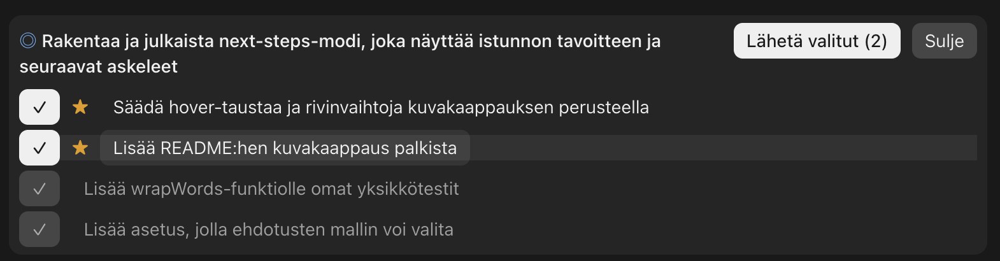

# next-steps

A Claude Code mod that shows, every time Claude finishes a task:

- **the goal of the session**, as Opus reads it from the whole conversation, kept stable from task to task, and
- **3–5 suggested next steps** that move toward that goal. The steps Opus recommends are starred (★) and already checked; a step Claude itself proposed or recommended in the conversation wears the Claude icon (✻ in the terminal) and is checked too. The last one or two are often **milestones** (◎): a bigger piece of the goal that Claude can drive on its own, choosing the smaller steps itself. Pick any combination and press **Send selected** to send them as your next prompt.

When Claude ends a task with a question (*"Should I fix this here or in a new PR?"*), the band shows that question (**?**) and turns the options Claude offered into the choices, with Claude's own recommendation marked with the Claude icon. A single picked reply is sent as it is.



The same band, drawn as text:

```
◎ Ship a login flow with tests                 [ Send selected (2) ]  [ Close ]

[✓] ✻ Run the tests in CI
[ ] Update the README
[✓] ★ Add logout
[ ] ◎ Take the login flow to done: tests, docs and a release
```

The suggested steps follow the language of your request.

## Install

At the prompt of a terminal session:

```
/plugin install next-steps --marketplace taromorimoto/next-steps
```

Answer `y` to add the marketplace, then pick a scope (user scope keeps it on in every session).

From a shell:

```
claude plugin install next-steps --marketplace taromorimoto/next-steps
```

In the desktop app, where `/plugin` does not run: click + next to the prompt box, then Plugins, Add marketplace with `taromorimoto/next-steps`, then Add plugin.

## Language

By default (`auto`) the labels follow the language of the conversation: the suggested steps' language when it is clear, else your request's (an undecided prompt falls back to your system locale, else English). To fix the language, set the `language` option to `en` or `fi`, either in the `/config` menu or from a shell:

```
echo '{"language":"fi"}' | claude plugin configure next-steps@next-steps --values-stdin
```

The suggested steps always follow the language of your request.

## Where it shows

- **Claude Code terminal and desktop app:** in the band right above the prompt box. Where a surface draws transcript rows, it goes under the answer instead.
- Click a step's checkbox or its text to pick it; the row lights up under the pointer. On the terminal, press 1–5.
- Interrupted turns and subagent work show nothing.

## Cost

Each finished task makes one extra model call: a fork of the session's own conversation, so the goal and steps see everything said so far. It runs on the session's model and reuses the prompt cache the session just warmed; with nothing to fork it falls back to one Opus call (low effort) over your last request and Claude's answer.

## License

MIT
